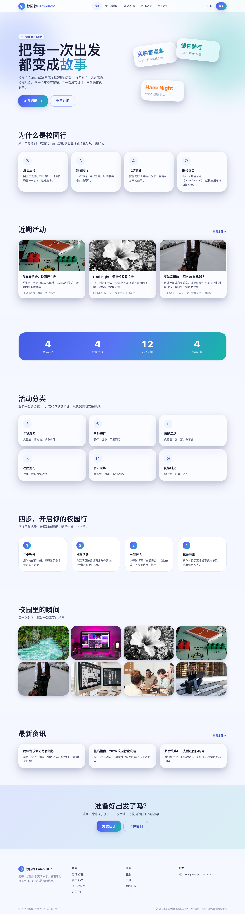
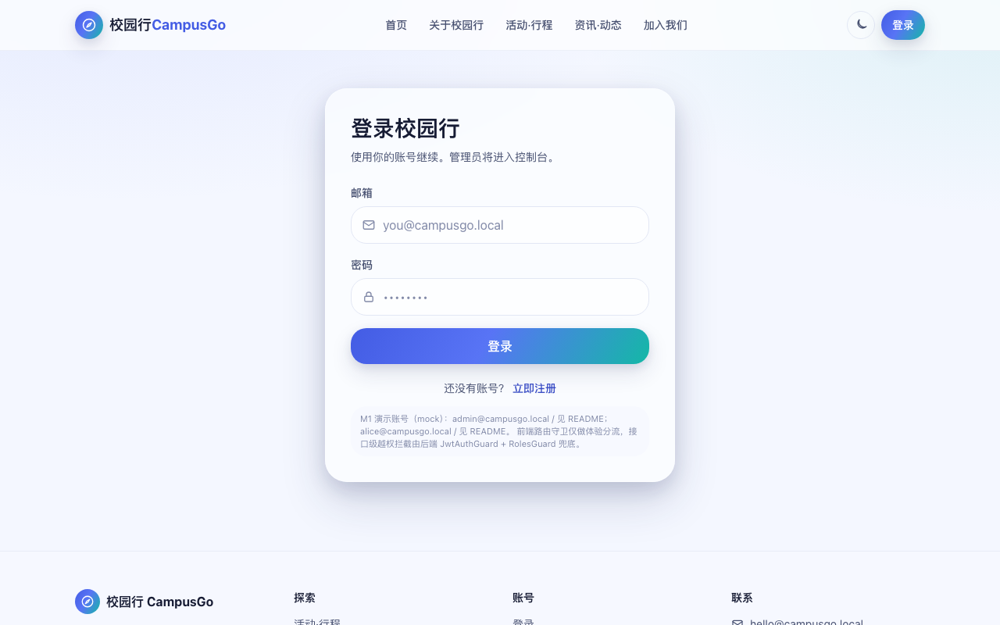
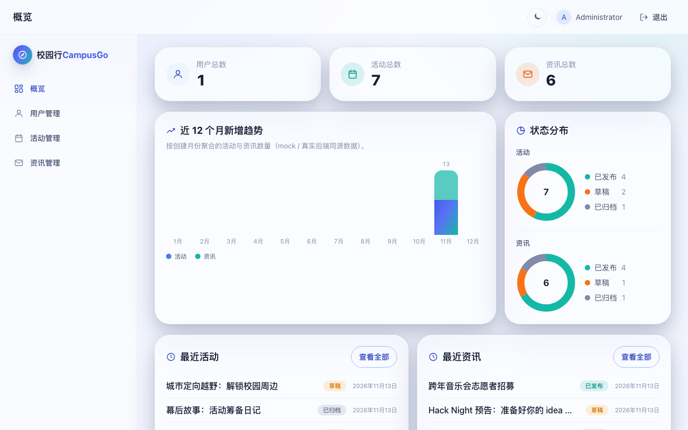
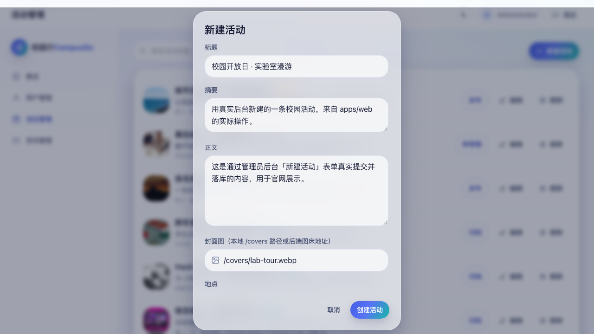
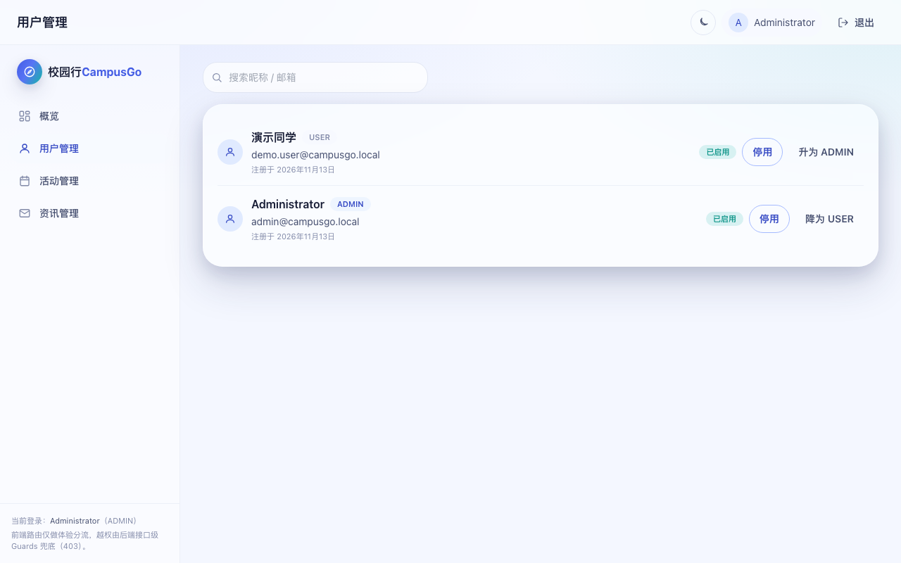

# 校园行 CampusGo · 官网展示模版

<p align="left">
  
  
  
  
</p>

> **一套拿来即套用的校园官网 + 后台展示模版**：改品牌名与文案、换内容数据即可复用；官网、登录注册、RBAC 后台、真实接口与 E2E 全链路已经串好。

这是一个**可复用的官网 / 后台展示模板**（不是某个内部系统的一次性交付）。主题是「校园行」，但你完全可以把它换成社团、赛事、实验室或任意活动的官网：品牌与站点文案集中、内容数据独立、主题走设计令牌，前后端分离且默认对接真实 API。仓库**保持 PRIVATE**；真实产品界面的录屏与截图都在仓库内，`clone` 后用本地相对路径即可打开，不依赖任何在线服务。

## ▶ 产品演示（真实界面录屏 · 仓库内相对路径）

[](docs/demo.webm)

**[`docs/demo.webm` · 点击打开真实产品界面录屏](docs/demo.webm)** —— `clone` 后用本地相对路径点开即可播放（中文硬字幕 + AI 中文旁白 + 轻音乐、循环友好；不联网、无 CDN、无外部字体/图片，零外部请求）。

- **录屏来源**：真实运行的 `apps/web` SPA，接真实全栈（Docker PG16 → `prisma migrate deploy` → `seed` → NestJS `3001` + Vite `5173`），录制时 `VITE_USE_MOCK` 不置 `true`，默认对接真实 API；前端为含 Fix-B（单点响应解包 + 品牌配置抽取）的最新 tip。画面依次展示官网首页 Hero 与活动/资讯卡片、活动列表与详情、注册/登录、管理员后台左栏 dashboard、用户管理（含 RBAC 安全边界提示）、活动管理的一次完整「新建 → 编辑 → 删除」（真实接口落库，可见「活动已创建 / 已更新 / 已删除」提示）、资讯管理，最后回到官网首页便于循环。
- **规格**：WebM（VP9）· 约 79 秒 · 1280×800 · 中文硬字幕 + AI 中文旁白 + 轻音乐 · 约 6.2 MB。用仓库已装的 Playwright（`@playwright/test` 1.63.0 + Chromium）`recordVideo` 录制，脚本见 [`scripts/capture-demo.mjs`](scripts/capture-demo.mjs)；录制时屏蔽一切外部请求，封面图用内联 SVG。
- **画面边界**：未出现真实密码、密钥、`.env` 内容或个人信息；管理员账号只在本地临时 `.env`（已被 `.gitignore`）里供录制时登录，不入库。

下面是**对运行中的 `apps/web` 实际截取**的 5 张截图（无头 Chromium，1280×800），不是占位图、不是外链、不是另画的 UI：

| 官网首页（近期活动真实数据卡片） | 注册 / 登录 | 管理员后台（左栏 dashboard 概览） |
|---|---|---|
|  |  |  |

| 活动管理 CRUD（新建/编辑/删除） | 用户管理 + RBAC 安全边界提示 |
|---|---|
|  |  |

---

## 特性

- **可复用模板**：官网展示 + 登录注册 + RBAC 后台三块解耦，目录结构清晰，按「如何套用到自己的项目」一节改几处即可换皮。
- **易改品牌与内容**：产品名 / Slogan / 导航 / 页脚集中在 `apps/web` 页面组件与 `index.html`；活动与资讯走接口数据，不写死在页面里；主色、圆角、字体走 Tailwind 设计令牌。
- **一键启动**：`docker compose up -d` 起 PG16，`pnpm install` 后按固定前置顺序即可起 server + web（命令见「快速开始」）。
- **无需真实后端也能看效果**：前端保留 `VITE_USE_MOCK=true` 演示开关（默认仍接真实 API），后端未起时也能浏览官网与后台展示；仓库内的 `docs/demo.webm` 是真实全栈界面录屏，`docs/screenshot-*.png` 是对运行中 `apps/web` 的实际截图，均可用本地相对路径打开、完全离线。
- **真实全栈联通**：NestJS + Prisma + PostgreSQL 16，Auth/JWT/RBAC、用户启停、活动/资讯 CRUD 都是真实接口；接口级 `JwtAuthGuard + RolesGuard` 是安全边界。
- **后台左栏 dashboard**：左侧固定模块导航 + 右侧内容区，用户 / 活动 / 资讯管理分栏清晰。
- **测试与门禁**：Playwright 契约结构回归 + 真实服务 E2E、CI 三包齐全后的真实 lint/typecheck/test/build 门禁、版本一致性报告。
- **立体视觉**：玻璃拟态 + 多层景深 + 3D tilt + 视差微动效，移动端优先并支持 `prefers-reduced-motion` 降级。
- **独立分发包 / 一键启动**：见 [`docs/STANDALONE.md`](docs/STANDALONE.md)（构建脚本、启动器、前置依赖与实跑验证命令）。

## 技术栈

| 层 | 选型 |
|---|---|
| 前端 | React 18 + TypeScript + Vite 5 + Tailwind CSS 3 + React Router + Zustand + Framer Motion |
| 后端 | Node.js 20 + NestJS 10 + Prisma 5 + PostgreSQL 16 |
| 鉴权 | JWT（access 15m / refresh 7d，刷新轮换）+ bcrypt + `USER`/`ADMIN` 双角色 + 接口级 Guards |
| 共享契约 | `packages/shared`：DTO / zod schema / `ErrorCode` / 角色与状态枚举，前后端共用单一来源 |
| API | RESTful，全局前缀 `/api`，统一响应体与错误码，Swagger(OpenAPI) 在 `http://localhost:3001/docs` |
| 测试 | Vitest（前端单元）/ Jest + Supertest（后端）/ Playwright（契约回归 + 真实服务 E2E） |
| 工程化 | pnpm workspace 单仓三包 + ESLint + TypeScript + GitHub Actions CI + Docker Compose |

## 快速开始

前置：Node 20+、pnpm 9+、Docker（含 Compose 插件）。

```bash
git clone https://github.com/0xAmoxicillin/campus-go.git     # 私有仓，需有权限
cd campus-go
cp .env.example .env                 # 按文件内注释替换占位符；.env 已被忽略，切勿提交
docker compose up -d                 # 启动 PostgreSQL 16
pnpm install                         # 与 CI 一致：--frozen-lockfile
pnpm --filter @campus-go/shared run build          # 前置①：产出 shared/dist
pnpm --filter @campus-go/server exec prisma generate  # 前置②：初始化 Prisma Client
```

端口与变量（全部对齐 `.env.example`）：

| 变量 | 值 / 用途 |
|---|---|
| `POSTGRES_USER` / `POSTGRES_DB` | `campusgo` / `campusgo` |
| `POSTGRES_PASSWORD` | 由 `.env` 提供，不落明文、不进日志与响应 |
| `DATABASE_URL` | `postgresql://campusgo:<password>@localhost:5432/campusgo?schema=public` |
| PostgreSQL | `localhost:5432` |
| `SERVER_PORT` | `3001`（NestJS；Swagger 在 `/docs`） |
| `WEB_PORT` | `5173`（Vite） |
| `VITE_API_BASE_URL` | `http://localhost:3001/api` |
| `VITE_USE_MOCK` | 默认 `false` 接真实 API；置 `true` 走前端 mock adapter，零后端看效果 |
| `ADMIN_SEED_EMAIL` / `ADMIN_SEED_PASSWORD` | 初始管理员，仅由种子脚本创建 |
| `JWT_ACCESS_SECRET` / `JWT_REFRESH_SECRET` | 部署前替换为强随机值，切勿提交 |

校验 compose 配置：`docker compose config`（无需启动容器即可验证变量与占位符一致）。

### 真实模式：把服务跑起来

```bash
# 1) 建表（可重复执行）
pnpm --filter @campus-go/server exec prisma migrate deploy
# 2) 种子管理员（幂等；用 .env 里的 ADMIN_SEED_*）
pnpm --filter @campus-go/server run seed
# 3) 两个终端分别起服务
pnpm --filter @campus-go/server run start       # http://localhost:3001  · Swagger /docs
pnpm --filter @campus-go/web run dev            # http://localhost:5173   · VITE_USE_MOCK 不置 true
```

浏览器按下面顺序真实走通一遍（用户明早要看的效果，照抄即可）：

1. 打开 `http://localhost:5173/register` → 注册一个普通账号（密码 ≥8 位、含大小写与数字）→ 自动进入 `/me`，角色 `USER`。
2. 用另一个浏览器/无痕窗口打开 `http://localhost:5173/login` → 用 `.env` 中的 `ADMIN_SEED_EMAIL` / `ADMIN_SEED_PASSWORD` 登录 → 角色分流进入 `/admin`，可见**左栏 dashboard + 右侧内容区**。
3. 后台「用户管理」→ 对某个 USER 点停用/启用（`PATCH /api/admin/users/:id`）。
4. 「活动管理」「资讯管理」→ 新建 → 编辑 → 删除，各走一遍完整 CRUD。
5. 越权验证：
   - 未登录直接请求 `http://localhost:3001/api/users/me` 或 `/api/admin/users` → `401 / code=40100`；
   - 用 USER 的 token 请求 `/api/admin/**` → `403 / code=40300`（前端 `AdminRoute` 也会给出无权限提示，但真正的安全边界在后端 Guards）。

### 演示模式：零后端也能看效果

- **看真实界面录屏与截图**：本地相对路径点开 [`docs/demo.webm`](docs/demo.webm) 看真实全栈 `apps/web` 界面录屏，或看 `docs/screenshot-*.png` 五张实际截图；二者都在仓库内、零外部请求、无需任何服务。
- **看真实 SPA 而不起后端**：在 `apps/web` 起前端时设 `VITE_USE_MOCK=true`，前端切到 mock adapter，官网与后台展示页照常渲染；此模式下所有响应来自前端 mock，不是真实数据库。默认 `VITE_USE_MOCK=false` 才接真实 API。
- 说明：真实注册/登录/JWT/CRUD 需要 PG16 + 后端 + `migrate deploy` + seed，无法在纯 mock 模式验证；演示与真实两套能力边界如实区分，互不冒充。仓库内的 `docs/demo.webm` 录的是**真实全栈**（非 mock 模式），其数据由真实接口落库；若你在本地用 `VITE_USE_MOCK=true` 复现界面，数据来自前端 mock，与录屏里的真实后端不同。

## 如何套用到自己的项目

1. **clone 本模板**：`git clone … && cd campus-go`（私有仓，需权限；转公开由仓库所有者决定）。
2. **改品牌 / 站点文案**：
   - 产品名与页面 `<title>`：`apps/web/index.html`；
   - 导航 / 页脚 / Hero Slogan / 栏目文案：`apps/web/src/components/layout/` 与 `apps/web/src/pages/`；
   - 主题主色、圆角、字体：`apps/web/tailwind.config.js` 与 `apps/web/src/index.css` 的设计令牌。
3. **改内容数据**：活动 / 资讯 / 用户信息走接口（`GET /api/activities`、`/api/posts`、`/api/admin/**`），接自己的数据源或在后台里录入即可，不必改页面结构；用 `VITE_USE_MOCK=true` 演示模式时数据来自前端 mock，真实模式由后端接口提供。
4. **启动看效果**：按「快速开始」真实模式起全栈，或用 `VITE_USE_MOCK=true` 演示模式零后端预览；也可本地点开 [`docs/demo.webm`](docs/demo.webm) 看真实界面录屏。
5. **接自己的后端**：只要保持 `docs/api-contract-v0.1.md` 的统一响应体与端点形状，把 `.env` 里的 `VITE_API_BASE_URL` 指向你的服务即可；若要改字段，按协作规范走 PR 同步更新 `packages/shared` + 契约文档 + Swagger。
6. **CI / 部署**：`.github/workflows/ci.yml` 的前置顺序照抄即可；密钥全部通过环境变量注入，`.env` 不入库。

## API 概览

契约事实来源：[`docs/api-contract-v0.1.md`](docs/api-contract-v0.1.md)（受控文档，本批不改）。Base URL `/api`；全部响应统一为 `{ code, message, data }`，成功 `code=0`（`ErrorCode.OK`）；错误码 `40100` 未登录、`40300` 越权、`40900` 冲突。

**`data` 形状**（按契约字面，前后端一律对齐）：

| 响应类型 | `data` 形状 | 端点示例 |
|---|---|---|
| 单点资源 | 统一再包一层 key | `GET /api/activities/:id` → `data.activity`；`GET /api/posts/:id` → `data.post`；`POST /api/activities/:id/join` → `data.enrollment`；`GET` / `PATCH /api/users/me` 与 `PATCH /api/admin/users/:id` → `data.user`；`POST` / `PATCH /api/admin/activities[/:id]` → `data.activity`；`POST` / `PATCH /api/admin/posts[/:id]` → `data.post` |
| 分页列表 | `{ items, total, page, pageSize }` | `GET /api/activities` · `/posts` · `/admin/users` · `/admin/activities` · `/admin/posts` |
| Auth 令牌对 | `{ user, accessToken, refreshToken }`（及 refresh 的 `{ accessToken, refreshToken }`） | `POST /api/auth/register` · `/login` · `/refresh` |
| 无返回体 | `null` | `POST /api/auth/logout`、`DELETE /api/admin/activities/:id` · `/api/admin/posts/:id` |

> 单点响应一律是 `{ "code": 0, "message": "ok", "data": { "activity": { … } } }` 这样的**两层结构**，不要把 `data` 直接当资源对象用；分页列表与 Auth 令牌对、DELETE null 保持上表原样。公开列表 / 详情只返回 `PUBLISHED` 内容。

| 分组 | 端点 | 权限 |
|---|---|---|
| Auth | `POST /api/auth/register` · `/login` · `/refresh` · `/logout` | 公开 |
| 用户自助 | `GET` / `PATCH /api/users/me`（PATCH 仅允许 `{name}`） | USER / ADMIN（Bearer） |
| 官网内容 | `GET /api/activities` · `/activities/:id` · `/posts` · `/posts/:id`，`POST /api/activities/:id/join` | 列表详情公开；报名需登录 |
| 管理员 | `GET /api/admin/users`，`PATCH /api/admin/users/:id` | 仅 ADMIN |
| 管理员 | `GET/POST /api/admin/activities`，`PATCH/DELETE /api/admin/activities/:id` | 仅 ADMIN |
| 管理员 | `GET/POST /api/admin/posts`，`PATCH/DELETE /api/admin/posts/:id` | 仅 ADMIN |

`user` / `enrollment` 视图固定白名单字段，**绝不返回 `passwordHash`**；`user` 视图为 `{id,email,name,role,status,createdAt}`，且 `PATCH /api/users/me` 不会改动 `email` / `role` / `status`。Swagger 注解与 21 个端点由 NestJS 生成：`http://localhost:3001/docs`。

## 安全与隐私

- **RBAC 红线**：注册接口硬编码 `role=USER`，请求体即便带 `role=ADMIN` 也一律忽略；初始管理员只由 `prisma/seed.ts` 种子脚本创建，不开放注册。
- **接口级边界**：`JwtAuthGuard + RolesGuard` 兜底，`/api/admin/**` 未登录 `401/40100`、USER 越权 `403/40300`；前端路由守卫只做体验分流。
- **口令与密钥**：密码 bcrypt 哈希后落库，绝不落明文、不进日志与响应；JWT 短时 access(15m) + refresh(7d) 轮换；`JWT_*`、`POSTGRES_PASSWORD`、`ADMIN_SEED_PASSWORD` 全部从 `.env` 读取，`.env` 已 `.gitignore`，**绝不入库**。
- **登录保护**：登录限流（42900）、CORS 白名单、Swagger 每接口标注所需角色。
- **本仓状态**：PRIVATE；未开 Pages、未编造任何在线演示/视频链接；真实界面录屏与截图都在仓库内，用本地相对路径打开，零外部请求。

## 目录结构

```
campus-go/
├── apps/
│   ├── web/                 # React 18 + Vite 官网 SPA / 登录注册 / 左栏后台控制台
│   └── server/              # NestJS + Prisma：Auth / RBAC / 内容 / Admin CRUD / Swagger
├── packages/shared/         # 共享 DTO · zod schema · ErrorCode · 角色枚举（契约单一来源）
├── scripts/
│   ├── e2e/
│   │   ├── fixtures/        # 契约 fixture（M1 拦截层）+ 真实服务 HTTP 客户端/环境配置
│   │   ├── specs/           # auth-flow / rbac（契约回归）· real-service（真实服务 E2E）
│   │   ├── playwright.config.ts       # 契约结构回归配置
│   │   └── playwright.real.config.ts  # 真实服务配置（webServer / 复用已起服务）
│   ├── capture-demo.mjs               # 真实 apps/web 界面录屏 / 截图脚本（Playwright）
│   └── check-version-consistency.sh   # 版本一致性报告（非阻塞）
├── docs/
│   ├── demo.webm            # 真实 apps/web 界面录屏（WebM/VP9，中文硬字幕 + AI 中文旁白 + 轻音乐）
│   ├── screenshot-*.png     # 对运行中 apps/web 实际截取的 5 张真实截图
│   ├── design-v0.1.md / api-contract-v0.1.md / collaboration-v0.1.md  # 受控文档，禁改
├── .github/workflows/ci.yml # 质量门禁 + 真实服务 E2E job
├── docker-compose.yml       # PG16（+ apps profile 预留 server/web）
├── .env.example             # 占位符模板（真实 .env 不入库）
├── pnpm-workspace.yaml / pnpm-lock.yaml / package.json
└── README.md
```

## CI 与本地复现

`.github/workflows/ci.yml` 在 `push`（`main`/`develop`/`feature/**`/`fix/**`）、对 `main`/`develop` 的 `pull_request` 触发；`quality-gate` 步骤顺序固定：

1. `pnpm install --frozen-lockfile` —— M2 三包已齐全、lockfile 覆盖全部 importer，干净 checkout 下不一致立即失败（M1 并行建包期用 `--no-frozen-lockfile`，M2 切回）。
2. **真实门禁前置（install 之后、Lint 之前，顺序不可乱）**：
   - `pnpm --filter @campus-go/shared run build`：产出 `packages/shared/dist`。干净 checkout 里 `dist/` 被忽略，而 server 的 typecheck/test/build 都 import `@campus-go/shared`，不先产出会报 `TS2307 / Cannot find module`。
   - `pnpm --filter @campus-go/server exec prisma generate`：初始化 Prisma Client，否则 Jest 报 `did not initialize yet`。此步不需要数据库可连。
3. `pnpm -r run --if-present lint` → `typecheck` → `test` → `build`：`--if-present` 必须放在 `run` 之后、脚本名之前（写反会透传给脚本本身，在零子包时伪装成绿、三包齐全后必红）。
4. `pnpm exec playwright install --with-deps chromium` + `pnpm run test:e2e:contract`（M1 契约结构回归，拦截层，无需服务）。
5. 版本一致性报告（**非阻塞**，`continue-on-error`）。

另有 `e2e-real` job：用 PG16 service 容器 → `prisma migrate deploy` → `seed` → 后台启动 NestJS(3001) + Vite(5173) → `pnpm run test:e2e:real` 打真实接口与页面。**它只在 `develop`/`main` 的 push（三路 M2 代码合并态）或手动 `workflow_dispatch` 时运行**：单个并行 feature PR 缺另外两路代码，跑真实联通必然失败且失败与本次改动无关，故不伪装全绿；合并态 CI 是否全绿由项目组长合并后实跑验证。

本地复现 CI 质量步骤（顺序与 `ci.yml` 一致）：

```bash
pnpm install --frozen-lockfile
pnpm --filter @campus-go/shared run build
pnpm --filter @campus-go/server exec prisma generate
pnpm -r run --if-present lint && \
pnpm -r run --if-present typecheck && \
pnpm -r run --if-present test && \
pnpm -r run --if-present build
pnpm exec playwright install --with-deps chromium
pnpm run test:e2e:contract      # 契约结构回归（19 用例，无服务可跑）
```

真实服务 E2E 本地跑法（需先按「快速开始」起好 PG + migrate + seed + server + web）：

```bash
ADMIN_SEED_PASSWORD='<.env 中的值>' pnpm run test:e2e:real
# 或让 Playwright 帮你起 server/web（PG 仍需先起好）：
E2E_START_SERVICES=1 ADMIN_SEED_PASSWORD='<.env 中的值>' pnpm run test:e2e:real
```

## E2E 覆盖

| 模式 | 命令 | 依赖 | 覆盖 |
|---|---|---|---|
| 契约结构回归 | `pnpm run test:e2e:contract` | 无（page.route 拦截 fixture） | 统一响应体 / 分页 / 401·403 红线判定，19 用例 |
| 真实服务 | `pnpm run test:e2e:real` | PG16 + NestJS + Vite + seed | 注册(USER)/登录/角色分流/越权 401·403/用户启停/活动·资讯 CRUD/单点资源包装形状/前端页面与分流，29 用例 |

真实服务用例断言统一响应体 `{code,message,data}`（成功 `code=0`）与分页 `{items,total,page,pageSize}`，并覆盖四类单点包装形状：`GET /activities/:id → data.activity`、`GET /posts/:id → data.post`、`POST /activities/:id/join → data.enrollment`、`PATCH /users/me → data.user`（且断言 `email/role/status` 未被越权改动）；同时验证「请求体带 `role=ADMIN` 仍得 USER」「USER 访问 `/api/admin/**` 一律 403」「`user` / `enrollment` 视图不泄露 `passwordHash`」「公开列表只列 PUBLISHED」。纯本地无 PG / 未起服务时该套件会明确失败并给出配置提示，**不会伪装全绿**。

## 里程碑状态

- **M1 完成**：契约先行（`packages/shared` + Prisma schema/migration + Swagger）、前端设计系统与官网静态页 + mock adapter、根 workspace + CI 门禁 + E2E 骨架 + 版本一致性脚本，三路 PR 已合并到 `develop`（基准 `de8e05e`）。
- **M2 真实功能**：后端 Auth/RBAC/Admin CRUD、前端官网实接 + **左栏 dashboard 后台**、全栈真实服务 E2E + CI 门禁切 `--frozen-lockfile` + 详细版 README + 真实 `apps/web` 界面录屏与 5 张实际截图，三路并行 PR 对 `develop` 开出，待项目组长逐行 Review 后合并。
- **M3+ 展望**：三方合并态 CI 实跑验证与版本一致性硬门禁、Docker 多阶段镜像与部署/回滚脚本、性能与 3D 视觉打磨、可访问性与 Lighthouse 达标。

## 协作与流程

- 私有仓免费套餐无法启用平台分支保护，改由流程门禁：禁止直接 push `main` / `develop`；`feature/*` → 对 `develop` 开 PR → CI 绿 + 项目组长逐行 Review 批准 → 由项目组长合并。
- 约定式提交，提交信息结尾 `Co-Authored-By: Claude Code <noreply@anthropic.com>`；PR 描述结尾 `🤖 Generated with [Claude Code](https://claude.com/claude-code)`。
- 三份受控文档（`design-v0.1.md` / `api-contract-v0.1.md` / `collaboration-v0.1.md`）禁改；契约变更必须走 PR 通知全组。

## License

MIT（见 [`LICENSE`](LICENSE)）。本模板为演示与学习用途，真实部署前请替换所有占位密钥并做安全评估。
